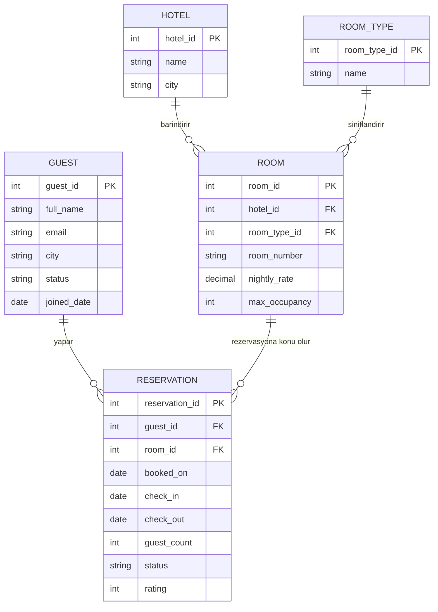

# ER Diyagramı: Otel Rezervasyon Sistemi

Sistem müşterileri, otelleri, oda tiplerini, otel odalarını ve belirli tarihler için yapılan rezervasyonları takip eder. Bir müşteri zaman içinde birden çok rezervasyon yapabilir; aynı oda da farklı tarihlerde birden fazla rezervasyonda yer alabilir.

## İlişkiler ve kardinaliteler

| İlişki | Kardinalite | Açıklama |
|---|---|---|
| HOTEL — ROOM | 1:N | Her oda bir otele aittir; bir otelde çok oda bulunabilir. |
| ROOM_TYPE — ROOM | 1:N | Her oda tek bir oda tipine bağlıdır; aynı tipte çok oda bulunabilir. |
| GUEST — RESERVATION | 1:N | Bir müşteri zaman içinde birçok rezervasyon yapabilir; rezervasyon tek müşteriye aittir. |
| ROOM — RESERVATION | 1:N (zaman içinde) | Bir oda farklı tarihlerde birçok rezervasyonda kullanılabilir; her rezervasyon tek odayı gösterir. |
| GUEST — ROOM | M:N (RESERVATION üzerinden) | Müşteri birden çok oda için rezervasyon yapabilir; oda farklı tarihlerde farklı müşterilerce rezerve edilebilir. |

`reservation` zayıf varlık değildir; kendi `reservation_id` anahtarı vardır. `uq_reservation_guest_room_check_in`, aynı müşteri–oda–giriş tarihi birleşiminin tekrar oluşturulmasını engeller. Tarih aralıklarının birbiriyle çakışmaması ayrı, satırlar arası bir iş kuralıdır.
